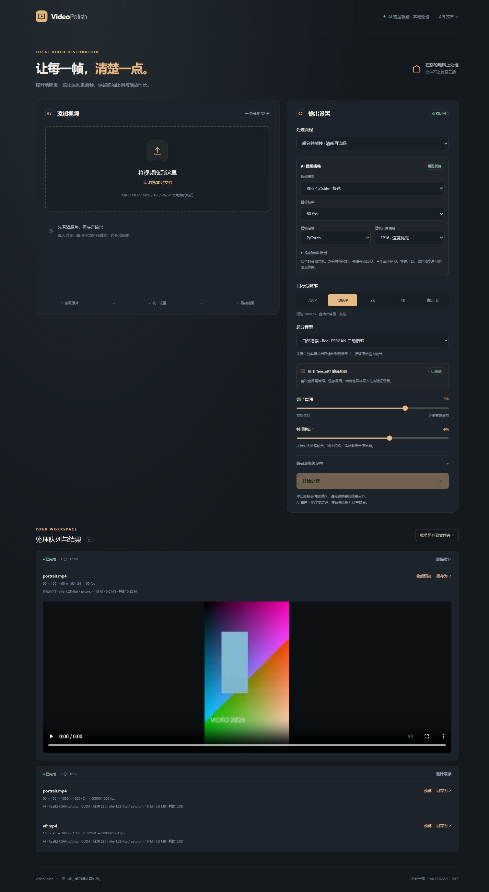

# VideoPolish

本地视频超分与插帧工作台。支持仅超分、仅插帧、超分并插帧，一份或多份视频、统一输出尺度/帧率、逐文件方案预览、后台队列、进度与预计剩余时间、结果预览、单份另存和批量另存到文件夹。网页和 API 使用同一处理管线。

[下载 Release](https://github.com/fantasyDeaddream/video_polish/releases/latest) · [API](docs/API.md) · [插帧与验证](docs/INTERPOLATION.md) · [发布说明](RELEASE_NOTES.md)



## Release 快速开始

从 Releases 下载 **VideoPolish-v1.2.0-with-models.zip**，校验同名 .sha256 文件后解压。包内包含六份超分模型、两份插帧模型和全部第三方许可说明。

运行需要 Python 3.10+，以及 requirements.txt 中的基础依赖；本项目已验证 Python 3.12.13 / PyTorch 2.5.1+cu121。可以复用已有 Conda / venv，也可以建立项目自己的环境：

```powershell
python -m venv .venv
# 使用 NVIDIA GPU 时，先按 PyTorch 官网安装与驱动匹配的 CUDA 版本。
.\.venv\Scripts\python.exe -m pip install -r requirements.txt
.\start.bat
```

[PyTorch 安装入口](https://pytorch.org/get-started/locally/)。已有合适环境时，通过 start.bat -Python 或 VIDEO_POLISH_PYTHON 指定即可，启动器不会修改已有环境。PyAV 缺失时安装到项目独立目录；TensorRT 通过 scripts/setup_acceleration.py 单独准备。ZIP 保持模型与依赖的第三方许可，不包含个人 Python 环境、视频缓存、日志或机器专用引擎。

从 GitHub 克隆源码时，先在选定环境安装依赖，然后准备全部模型：

```powershell
python scripts/runner.py scripts/prepare_models.py
.\start.bat
```

GitHub 自动生成的 Source code ZIP 只包含源码；附带模型的发布包请下载 with-models.zip。详细打包方式见 [发布指南](docs/RELEASING.md)。

## 在这台电脑上使用

在 PowerShell 7 中，或双击脚本：

```powershell
cd C:\path\to\video_polish
.\start.bat
# 后台运行；可以关闭启动窗口。
.\stop.bat
```

默认网页：<http://127.0.0.1:8800>。交互式 API 文档：<http://127.0.0.1:8800/docs>。端口被其他程序占用时，自动尝试随后 19 个端口，实际地址会在启动输出中显示。

```powershell
.\start.bat -NoBrowser -Port 8800
pwsh -NoProfile -File .\scripts\server.ps1 -Action status
```

WSL Ubuntu：

```bash
cd /mnt/c/path/to/video_polish
bash start.sh --no-browser --port 8800
bash stop.sh
```

WSL 默认通过 Windows 互操作调用 PowerShell 7，使用同一个 Windows Python、CUDA、服务记录和缓存，避免另装一份 PyTorch。Windows 与 WSL 的停止脚本可以互相管理这个服务。需要 WSL 允许 Windows 互操作。原生 Linux 路径也已提供：设置 `VIDEO_POLISH_NATIVE_WSL=1`、`VIDEO_POLISH_PYTHON=/path/to/python`，此路径尚未完成原生 Linux GPU 实测。

**运行 stop.bat / stop.sh 会终止当前任务并清除本项目 `cache/uploads`、`cache/results`、`cache/tmp` 下所有内容。请先另存结果。** 用户原文件、另存到其他目录的副本、模型和依赖保留。未启动时运行停止脚本同样清理；重复停止安全。正常服务退出也会清理。断电或强杀后的残留在下次启动时清理。

## 已有环境的复用

本机默认复用 `../pic_polish/.venv/Scripts/python.exe`（Python 3.12.13，来自 Conda `gnn`，PyTorch 2.5.1+cu121），并只读使用 `../pic_polish/models` 中的官方权重。不会向图片项目或已有 Conda 环境安装、升级或删除包。

新增的 PyAV 16.1.0 装在本项目 `.deps/win32-312/`；其 wheel 已核对 PyPI 发布的大小和 SHA256。启动器在子进程中临时添加该依赖目录，不改全局 PATH、pip 或 Conda 配置。`scripts/setup.py` 可重新准备缺失的 PyAV，下载器有真实字节测速、低速换源与 SHA256 校验。

可显式选择环境：

```powershell
$env:VIDEO_POLISH_PYTHON = 'E:\ProgramData\anaconda3new\envs\deepseek\python.exe'
.\start.bat -NoBrowser
# 或 .\start.bat -Python '完整的 python.exe 路径'
```

候选环境须有 Python 3.10+、torch、numpy、cv2、fastapi、uvicorn、python-multipart。默认优先上次选中的环境、项目 `.venv`、图片项目 `.venv`，再检查本机 Conda 环境。缺失这些基础包时明确报告，不自动修改共享环境。

权重查找顺序：环境变量 `VIDEO_POLISH_MODELS` 指定目录 → 当前项目 `models` → 相邻图片项目 `models`。原有三份 RRDB 权重继续只读复用；另提供通用轻量、通用弱降噪和动漫视频轻量三份 SRVGG 权重，下载于本项目 `models`，可运行 `scripts/runner.py scripts/fetch_models.py` 准备。移动本项目时，请一并提供权重或设置模型目录。来源见 [研究记录](docs/RESEARCH.md)。缺失或损坏权重会报告失败，不会暗中把插值称为 AI 超分。

## 分块、流水线和 TensorRT

网页的“编码与高级设置”支持 128 / 256 / 384 / 512 / **768 / 1024 / 1536 / 2048** 分块，默认仍为原来的 256。大分块会增加显存使用，实际加速与模型和输入形状有关。显存不足会自动缩小分块，并记住本次输入的有效值，避免每帧反复触发 OOM。

当前工程优化在同分块下保持原算法：每帧整幅上传一次，在 GPU 按原边界分块、逐块推理并拼接，再下载完整原生输出一次；最终缩放继续使用同一 CPU Lanczos4。并行管线用有界队列将解码、CPU 光流/编码与单队列 GPU 推理重叠执行，不跳帧、不改变时序。网页可关闭管线，API 使用 `pipeline=false`。

**默认 720P→1080P 仍先通过 x2plus 生成 2560×1440，再缩至 1920×1080。** 工程优化不降低输入分辨率，也不改为近似缩放。不同分块可能因网络上下文和数值算法产生细小差异，工程一致性测试固定相同分块。

TensorRT 是独立的可选组件，网页有启用开关及 FP16/FP32 精度选择，默认关闭。当前已在本项目 `.deps/tensorrt-win32-312` 中安装 TensorRT 10.10.0.31、ONNX 1.17.0、protobuf 5.29.5 和 CUDA runtime 12.8.90，原 Conda/PicPolish 环境未改动。需要重新准备时：

```powershell
& ..\pic_polish\.venv\Scripts\python.exe scripts\runner.py scripts\setup_acceleration.py
```

首次启用某个模型/精度/形状配置需要编译，可能耗时数分钟；阶段会显示在任务中。后续复用 `.runtime/tensorrt` 中缓存，引擎和 ONNX 属于非视频成果，停止脚本保留。TensorRT 不承诺逐像素相同，会在每个新分块形状的实际输入上检查与 PyTorch 的差异，记录 MAE、最大像素差、PSNR、SSIM；超过阈值则停止并给出说明。

轻量模型与原 RRDB 的纹理表现不同；TensorRT 的数值差异与切换模型的效果变化分别验证。速度、显存及画质一致性报告见 [docs/ACCELERATION.md](docs/ACCELERATION.md)。

## 视频插帧（1.2）

“处理流程”可选择仅插帧或超分并插帧。提供 RIFE 4.25 标准版和 4.25.lite 快速版；目标帧率支持 2倍 / 4倍 / 48 / 50 / 60 / 120，以及 60000/1001 等自定义分数帧率，上限 240fps。仅插帧保留显示尺寸；组合流程对原始帧先超分和时序稳定，再在最终尺寸生成中间帧，超分推理次数保持为原始帧数。

默认仍为仅超分。关闭插帧时执行原来的视频处理分支；720P→1080P 的原生 x2 后缩放逻辑保持。插帧保持播放时长和音轨，支持原始 PTS 调度、末帧尾段保持、重复帧复用与切镜检测。严格目标帧率下，24→60 不会保留每个原始时间点。慢动作与降帧转换不在此模式范围内。

本机两份官方权重已准备于 models/rife。迁移项目或补齐模型时：

```powershell
& ..\pic_polish\.venv\Scripts\python.exe scripts\runner.py scripts\fetch_interpolation.py
```

适配后的推理直接复用 Python 3.12 / PyTorch 2.5.1，不安装上游旧版依赖。模型配套代码和官方包散列保存在 models/rife/manifest.json；应用只加载校验过的张量权重，不导入下载包中的 Python 文件。

插帧有独立的 PyTorch / TensorRT 后端及 FP16 / FP32 精度选项，和超分 TensorRT 分开控制。TensorRT 按实际尺寸首次编译，缓存于 .runtime/rife-tensorrt；光流变形保持 FP32 坐标。实际输入会在不同插值时刻与同精度 PyTorch 比较；超过阈值则明确失败，请改用 FP32 或 PyTorch。较小的插帧内部尺度可减少开销，但可能改变画质，需要自行对照；不会自动降低该设置。

使用说明与本机验证记录见 [docs/INTERPOLATION.md](docs/INTERPOLATION.md)。

## 下载代理

项目下载器对非 CN 来源依次尝试 **http://127.0.0.1:7900 → http://127.0.0.1:7897 → 直连**；.cn 域名及已知国内镜像直连。PyAV、TensorRT 和模型准备脚本均使用该策略，下载记录包含代理、真实字节速度和 SHA256。端口按 HTTP/CONNECT 代理使用，不修改 Windows、Conda 或全局 pip 设置。本机 WebUI / API 始终直连。

可在当前启动终端临时覆盖：

```powershell
$env:VIDEO_POLISH_DOWNLOAD_PROXY = 'http://127.0.0.1:7897,http://127.0.0.1:7900'
# 或设为 'direct' 强制外站直连；国内来源仍直连。
```

## 尺寸规则

| 选项 | 基准 | 横屏 1280×720 输出 | 竖屏 720×1280 输出 |
| --- | --- | --- | --- |
| 720P | 短边 720 | 1280×720 | 720×1280 |
| 1080P | 短边 1080 | 1920×1080 | 1080×1920 |
| 2K | 长边 2560 | 2560×1440 | 1440×2560 |
| 4K | 长边 3840 | 3840×2160 | 2160×3840 |
| 自定义 | 自选长边/短边，16–7680 整数 | 按比例计算 | 按比例计算 |

计算使用显示宽高比，支持非方形像素（SAR）和旋转标记。为兼容 H.264 4:2:0，两边取最近偶数，所选边可能偏差 1px，另一边误差通常不超过 1px。API 返回实际宽高及比例误差。不裁切、不补黑边。输出最长边上限 7680、总像素上限 3400 万。目标相同或更小则跳过神经网络，执行高质量缩放。

## 图像处理方式

- 默认自然增强：比例不超过 2 倍时选 Real-ESRGAN x2plus，否则选 x4plus；动漫模式选 Anime 6B。CUDA 可用时用半精度；CPU 可运行但较慢。输入分块带 24px 上下文，显存不足自动缩小分块。
- 通用轻量 SRVGG x4v3、通用 WDN 弱降噪及 AnimeVideo v3 提供不同的速度和细节取舍；均按原生 4 倍超分后缩到目标尺寸。
- 在精确目标尺寸上，将网络结果与 Lanczos 基底按“细节增强”强度融合，减少过强纹理。不会额外全局锐化。
- 用原始帧的双向 Farnebäck 光流对齐前帧的神经增强残差，通过光度误差、正反向一致性和越界掩码排除不可靠区域。只融合增强残差；场景切换重置，前帧残差不递归累计。
- 仅超分时保留输入帧的时间戳和帧序列，兼容可变帧率。启用插帧后按目标时钟生成中间帧，保持播放速度。光流稳定与插帧是两个独立步骤。
- 输出为 SDR、BT.709、H.264 / MP4，默认 CRF 18。保留全部音频轨：AAC 压缩包直接复制，其余转 AAC。字幕、章节、附件和原始容器元数据不随输出保留。网页以 MP4 预览，支持 HTTP Range。

“真实增强”指实际加载官方神经网络进行重建，插值模式会明确标注。AI 无法保证还原拍摄时已经丢失的真实纹理，也可能改变文字或人脸细节。建议先用短片调整参数。超过模型原生 2x/4x 的目标会在模型输出后继续缩放，不代表原生高倍率重建。

本版本明确拒绝 HDR/PQ/HLG 和隔行视频，避免静默出现错误色彩或梳齿；请先转 SDR / 去隔行。分辨率中途变化、重复或倒退的时间戳会报错。测试素材覆盖常见逐行 SDR 场景。

## 缓存和保存

视频逐帧解码、处理、编码，不生成整段 PNG 帧缓存。每份输入完成或失败后立即删除上传副本；取消、删除、停止会移除相应视频。默认保留完成结果和未开始批次 24 小时，后台自动过期清理；容量默认 80GiB，每批上传默认最多 20GiB / 32 份，磁盘不足时停止。

在启动前可设置 `VIDEO_POLISH_TTL_HOURS`、`VIDEO_POLISH_MAX_CACHE_GB`、`VIDEO_POLISH_MAX_UPLOAD_GB`。`GB` 配置值以 GiB（1024³字节）计。浏览器上传的 multipart 临时文件由框架管理并在请求结束时关闭。

Chrome / Edge 在本机地址支持系统“另存为”和文件夹选择，采用流式写盘，避免将整个输出放进浏览器内存。其他浏览器使用普通下载；批量时可能需要允许多文件下载。停止脚本通过随机口令请求本地优雅退出；强制终止前核对进程创建时间，防止 PID 被复用后误杀其他程序。

## API 与验证

完整请求格式和 Python 示例见 [docs/API.md](docs/API.md)，可以直接运行 `scripts/api_client.py`。

```powershell
& ..\pic_polish\.venv\Scripts\python.exe scripts\runner.py scripts\api_client.py --output D:\Videos\upscaled "D:\Videos\input.mp4"
```

验证命令（复用环境中的 pytest、httpx）：

```powershell
New-Item -ItemType Directory -Force tests\artifacts | Out-Null
& ..\pic_polish\.venv\Scripts\python.exe scripts\runner.py pytest tests\test_core.py tests\test_api.py -q
.\start.bat -NoBrowser
& ..\pic_polish\.venv\Scripts\python.exe scripts\runner.py tests\e2e.py
```

实测证据见 [docs/VALIDATION.md](docs/VALIDATION.md)。测试样片和报告保存在 `tests/artifacts`，属于明确另存的验证成果，停止脚本不会清除。`logs/server.log` 和 `logs/server.err.log` 记录服务日志。默认只监听本机；通过 `-BindHost 0.0.0.0` 暴露给局域网时需要自行控制访问，此应用没有用户登录系统。

本项目采用 MIT；第三方网络、模型和依赖的许可见 [THIRD_PARTY_NOTICES.md](THIRD_PARTY_NOTICES.md)。
